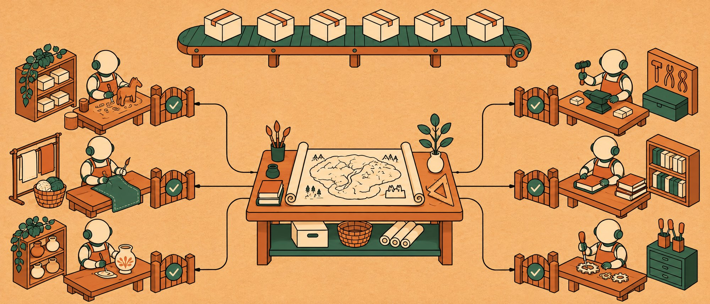
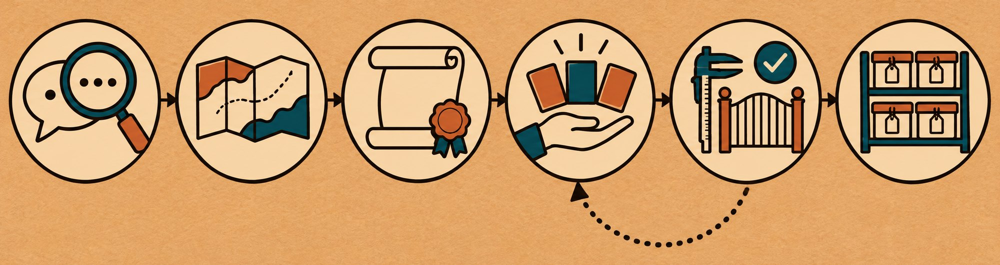
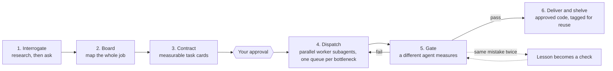

<p align="center">
  
</p>

<h1 align="center">atelier-software</h1>

<p align="center">
  <strong>Run software projects with Claude Code like a workshop, not a crowd.</strong><br>
  One lead turns your short request into a measurable contract, maps the whole job,<br>
  dispatches parallel subagents, and lets nothing merge without an independent gate.
</p>

<p align="center">
  <a href="LICENSE"></a>
  <a href="https://github.com/erkandmrbas/atelier-software/actions/workflows/validate.yml"></a>
  
  
</p>

---

## Why

Adding subagents is easy. Making them work on one codebase without breaking each other's work is the hard part.
Left alone, an agent writes average code, says "tests pass" when it edited the tests, and repeats the same mistake next week.
Ten subagents do all of that ten times in parallel, in the same repository.

atelier-software puts a workshop around Claude Code. The speed does not come from the agents. It comes from the order around them.

| Without atelier-software | With atelier-software |
| --- | --- |
| "Make it better" and hope | A contract with numbers: *p95 under 200 ms*, *coverage of changed lines at least 80%* |
| Agents start before anyone knows the whole job | The whole job is mapped on a board before any work starts |
| "Done!" in chat | Done means a handoff note exists **and** a different agent passed the gate |
| Same bug, third time | Second time a mistake happens, it becomes a check that blocks it forever |
| Two workers writing migration 0042 at once | Shared bottlenecks run through one queue |
| Your feedback is forgotten next session | Every rejection is logged with its date and read before the next proposal |

## Install in 30 seconds

Inside Claude Code:

```text
/plugin marketplace add erkandmrbas/atelier-software
/plugin install atelier-software@atelier-software
```

Requires Claude Code and Python 3.9 or newer (standard library only). Shell commands, local development, updates and uninstall: [docs/install.md](docs/install.md).

For video production, see [atelier-video](https://github.com/erkandmrbas/atelier-video).

## Use it

In any repository, start with:

```text
/atelier-software:start add CSV export to the reports page
```

The lead then works through the stations, and stops for your approval where it matters:

<p align="center">
  
</p>



## The 11 rules

1. **Interrogate first.** Read the code, then ask. Every question comes with a recommended answer, so you can reply "go with your recommendations".
2. **Map the whole job before any work.** Pieces, dependencies, parallel groups, shared bottlenecks such as migrations, lockfiles and the CI build.
3. **One lead.** You talk to one agent. It turns "add password reset" into a contract and dispatches the pieces.
4. **Four parts per task:** goal, constraints (*never edit a test to make it pass*), a quality bar with numbers (*p95 under 200 ms*), examples (*match the existing export endpoint*). Plus an approval checkpoint.
5. **Brief workers lightly.** Fixed decisions, the bar, and what is deliberately left open. "p95 under 200 ms", not "add an index on `created_at`".
6. **State lives in files.** The lead writes the cards; a worker writes a handoff note. No handoff note, not finished. Any session can resume from the files after a crash.
7. **Gates at every exit.** One subagent writes the code, a different subagent runs the tests and measures. Failed work does not merge.
8. **The same mistake twice goes into code,** not into a note: a check that fails the gate on a skipped test or a stray `console.log`.
9. **Cheap draft first,** expensive final after approval: an interface stub before the implementation, a migration on 100 rows before the real database. Tag everything; reuse from the shelf.
10. **Parallelism is limited.** Default 4 workers. Migrations, lockfiles, the build and deploys go through one queue each.
11. **You have the final word.** Rejections are logged with dates. No "tests pass" is trusted until a reviewer ran them.

The reasoning behind each rule: [docs/method.md](docs/method.md).

## What is inside

| Part | What it does |
| --- | --- |
| **9 skills** | `start`, `interrogate`, `board`, `contract`, `dispatch`, `gate`, `draft-first`, `lessons`, and `profile-software`, which `start` always loads: constraints, quality bar defaults, a file-ownership map and queues for code work |
| **3 subagents** | `atelier-software:worker` builds one card, `atelier-software:reviewer` runs the tests and writes the gate report, `atelier-software:researcher` reads the code before anyone builds |
| **`atelier.py`** | A dependency-free CLI that enforces the rules: card checks, handoff checks, gates, lessons, rejections, shelf |
| **3 hooks** | A worker cannot stop without a handoff note; the lead cannot stop with a task marked done that did not pass its gate; every session starts with the board and your past rejections |

Every repository gets one folder of shared state, safe to commit:

```text
.atelier/
├── contract.md      the measurable contract (lead only)
├── board.md         the map of the whole job (lead only)
├── tasks/T-01.md    task cards (lead only)
├── handoffs/T-01.md handoff notes (worker; none means not finished)
├── gates/T-01.md    gate reports (reviewer, never the worker)
├── checks/          automated checks born from repeated mistakes
├── lessons.md       every mistake, tagged and counted
├── rejections.md    what you did not like, with dates
├── shelf.md         approved outputs, tagged for reuse
└── bin/atelier.py   the CLI, copied in so every agent can run it
```

## The gate, in practice

A worker tried to sign off its own webhook-retry change with `result: pass`. Real output, trimmed:

```console
$ python3 .atelier/bin/atelier.py gate T-02
PASS card front matter id is T-02 (found 'T-02')
PASS card section 'Quality bar' is filled
PASS card quality bar holds at least one number
PASS handoff section 'Against the quality bar' is filled
FAIL reviewer 'worker-2' is not the handoff author (a different agent must review and write the gate report .atelier/gates/T-02.md)
FAIL reviewer 'worker-2' is not the card owner (a different agent must review and write the gate report .atelier/gates/T-02.md)
FAIL reviewer 'worker-2' is the one assigned on the card (reviewer-1); only that reviewer writes .atelier/gates/T-02.md
PASS the card's quality bar is unchanged since this review
PASS gate result is pass (found 'pass')
PASS no repeated lesson without a check
Gate T-02: FAIL. The work does not move on until every line passes.
```

Nothing moves to `done` until every line says `PASS`. Not even if the worker insists. And a pass does not last forever: if the card's quality bar or the handoff note changes after the review, the gate fails until the assigned reviewer measures again and writes a new report.

## Examples

- [Adding password reset to a web app](docs/example-software.md): six task cards, three parallel workers, a migration queue, a gate that catches an edited test, and a skipped test that becomes a check.

## FAQ

**What kind of work is it for?** Features, refactors, migrations and bug hunts: any software job too big for one reply or one session.

**Is it overkill for a one-line fix?** Yes. `start` has a fast path for small jobs and tells you when to skip the method.

More: [docs/faq.md](docs/faq.md).

## Contributing

Issues and pull requests are welcome. This repository is built with its own method: see [CONTRIBUTING.md](CONTRIBUTING.md).

## License

[MIT](LICENSE)
